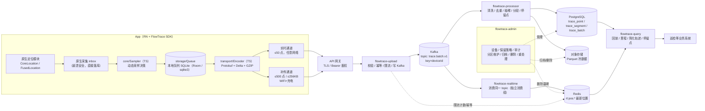
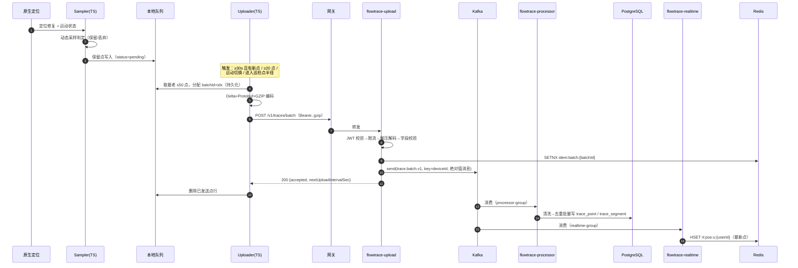
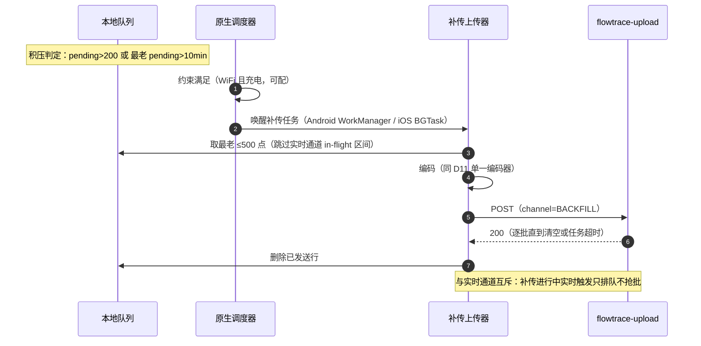
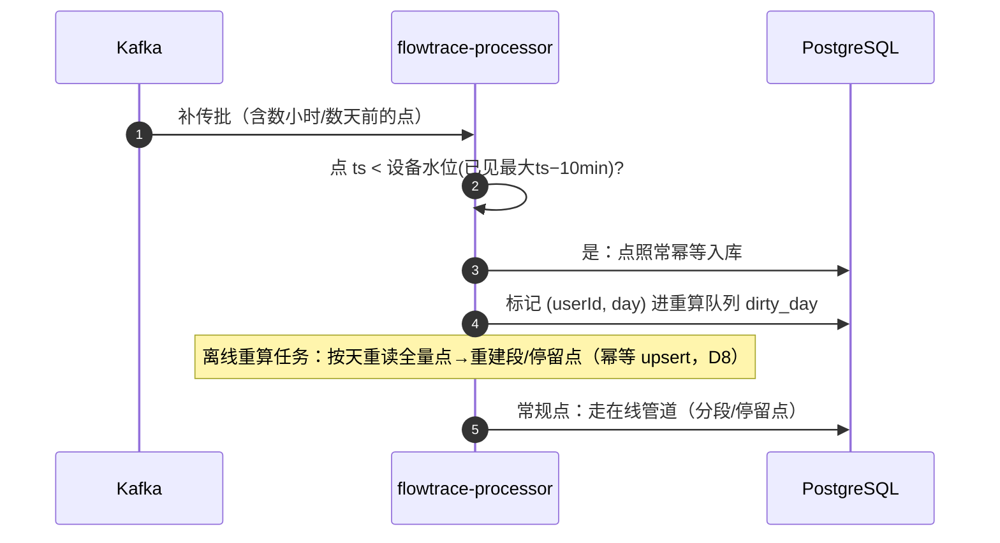
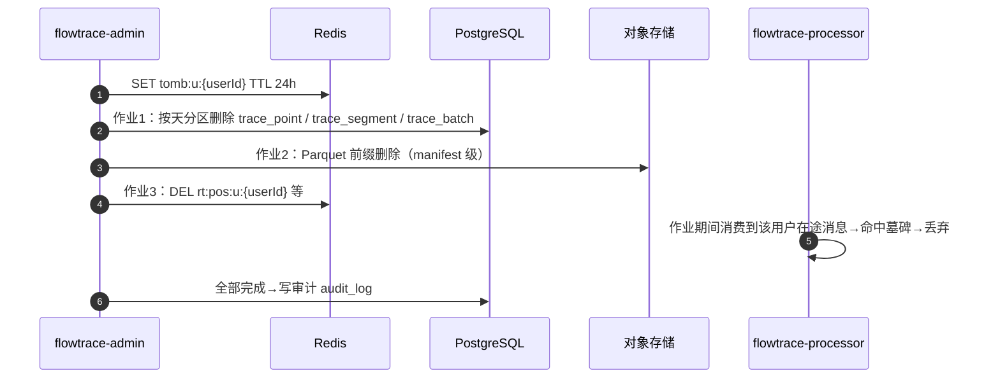

# 01 总体设计

> 上游：[AGENTS.md](../../AGENTS.md)（硬性约束）｜ 本文档目录：[README.md](README.md)

## 1. 系统概述

FlowTrace 是轨迹采集与回溯平台：App 端（React Native SDK）采集定位点 → SQLite 本地队列缓存 → 双通道批量压缩上报（Protobuf + Delta + GZIP）→ flowtrace-upload 接入 → Kafka → flowtrace-processor 异步处理 → PostgreSQL / Redis / 对象存储 → flowtrace-query 查询与回放。为巡检等业务提供轨迹佐证，**不承担巡检业务逻辑**。

技术基线（已由仓库构建骨架确定，设计文档全部以此为前提）：

| 项 | 基线 |
|---|---|
| 后端语言/运行时 | Kotlin 2.3.21，Java 21 toolchain，虚拟线程（`spring.threads.virtual.enabled=true`） |
| 应用框架 | Spring Boot 4.1.2，`spring-boot-starter-webmvc` + `starter-validation`（Jackson 3 / tools.jackson） |
| ORM / DB | Exposed 1.0.0-beta-4（含 exposed-migration）+ PostgreSQL 16（普通表，无 PostGIS）；DDL 变更由 Exposed migration 管理（表定义为唯一事实源，决策 D16） |
| 消息 | Kafka 3.x + spring-kafka（`trace-messaging` 模块封装） |
| 缓存 / 最新位置 | Redis 7（Lettuce，`storage-redis` 模块封装） |
| 空间计算 | JTS 1.20（应用层抽稀/拓扑）+ 自研 GeoMath（haversine 里程/方位，见决策 D7） |
| SDK | React Native 标准库工程（create-react-native-library / bob + codegen，turbo-module），TypeScript 源码 + Android(Kotlin/Room) + iOS(Objective-C/sqlite3) |

## 2. 目标指标（验收口径）

| 指标 | 目标 | 测量点 |
|---|---|---|
| 有网上报成功率 | > 99%（滚动日） | SDK 上报计数（成功批 / 尝试批）与服务端 `trace_batch` 对账 |
| 实时通道最新点端到端 | ≤ 30s（网络正常） | 点 `ts` → Redis `rt:pos` 写入时刻 |
| 整体端到端（点可查询） | < 1min | 点 `ts` → `trace_point` 可查 |
| 查询 P95 | < 500ms | flowtrace-query 接口耗时（不含业务侧网络） |
| 管道容量 | 10 亿点/天设计上限 | Kafka 入流 + processor 落库速率（见 §8 容量估算） |
| 单批接入耗时 | flowtrace-upload p99 < 50ms（不含网络） | 服务端内部计时 |

非目标（明确不做）：

- 不做巡检业务逻辑（打卡判定、任务流转等），只提供 `taskId/sessionId` 关联与查询。
- 不引入 ClickHouse、不启用 PostGIS（已决策，不再评估）。
- 不做实时推送（WebSocket/SSE 推最新位置）——P2 再议，当前最新位置走轮询 `GET /v1/users/{userId}/location`。
- 不做端到端加密，传输层安全由 TLS 保证。
- 不做多租户计费/配额体系（保留策略按用户/全局配置即可）。

## 3. 总体架构



主链路（只做轨迹的采集、上报、处理、查询）：

```
采集 → 本地队列 → 批量上报 → 接入 → Kafka → 处理 → 存储 → 查询
```

三条铁律（源自 AGENTS.md，任何实现不得违背）：

1. `flowtrace-upload` 只做校验、幂等、限流、写 Kafka 后快速返回；重处理逻辑一律在 `flowtrace-processor`。
2. 巡检业务通过 `taskId/sessionId` 关联和消费轨迹结果，不得侵入上报主链路。
3. 空间计算全部在应用层（JTS + GeoMath），不在数据库做地理查询。

## 4. 模块清单与职责边界

| 模块 | 职责 | 明确不负责 | 部署形态 |
|---|---|---|---|
| `proto/` | 上报协议 `trace.proto` + 内部消息 `trace_message.proto` + 一致性测试向量 | — | 源码目录（后端/SDK 共用） |
| `platform/common` | 通用能力四合一：配置装载、错误码、ID 生成（UUIDv5/v7）、时间工具 + MVC 基座（鉴权过滤器、全局异常→错误体、指标、日志 traceId、健康检查）+ JWT 解析/JWKS 缓存/scope 模型 + Micrometer/OTel/结构化日志规范 | 业务逻辑、用户体系（外部 IdP） | 库 |
| `libs/trace-model` | 领域对象（TracePoint/Segment/Batch…）+ GeoMath（量化、haversine、方位、局部投影） | 编解码 | 库 |
| `libs/trace-protocol` | 上报批解码（Delta→绝对值）、校验、内部消息编解码、golden vector 测试 | 存储/消息 | 库 |
| `libs/trace-messaging` | topic 常量、幂等 producer 封装、消费者配置模板、DLQ 封装 | 业务处理 | 库 |
| `libs/trace-storage/storage-postgres` | Exposed 表定义、PartitionManager、批量写入封装 | 业务语义 | 库 |
| `libs/trace-storage/storage-redis` | key 规范、幂等 SETNX、限流 Lua、最新位置读写封装 | — | 库 |
| `services/flowtrace-upload` | 批量上报接入：鉴权→限流→解码→校验→幂等→Kafka→响应（含调速） | 落库轨迹数据 | 库模块（flowtrace-app 装配） |
| `services/flowtrace-processor` | 消费 Kafka：清洗、去重、写点、分段、停留点、抽稀；DLQ；补录重算 | 对外 API | 库模块；容量需要时拆出独立部署 |
| `services/flowtrace-query` | 轨迹/段/停留点/里程/回放查询，简化 LUT | 写路径 | 库模块（flowtrace-app 装配） |
| `services/flowtrace-realtime` | 消费 Kafka 更新 Redis 最新位置 | 历史查询 | 库模块；可拆出独立部署 |
| `services/flowtrace-admin` | 设备管理、保留策略、分区维护、归档、删除作业、重处理、审计 | 主链路写入 | 库模块（flowtrace-app 装配） |
| `sdk/react-native-flowtrace` | 采集、采样、队列、编码、双通道上报、地理围栏、隐私 | 服务端任何逻辑 | npm 库 |

当前部署形态为**多模块单体（决策 D15）**：`services/flowtrace-app` 为唯一启动模块，聚合全部五个服务库模块与一份 `application.yml`。**模块边界不变**（独立 Gradle 模块、独立包名，禁止互相 import 内部实现，只允许依赖对方公开 API 模块——推荐直接通过 Kafka/Redis/PG 解耦，服务间零 HTTP 调用）。容量需要时优先把 `flowtrace-processor`、`flowtrace-realtime` 拆出独立启动模块部署：只加启动模块，不改库模块代码。

## 5. 关键技术决策记录（ADR）

> 已由 AGENTS.md 锁定、不再讨论的：不引入 ClickHouse；P 阶段不启用 PostGIS；DDL 变更用 Exposed migration 管理（不引入 Flyway/Liquibase）；部署形态为多模块单体（platform 四模块已合并为 `platform/common`）；SDK 用标准 RN 库工程；上报编码 Protobuf+Delta+GZIP。下表是详细设计阶段补充的决策。

| # | 决策 | 理由 | 影响面 |
|---|---|---|---|
| D1 | 坐标全链路整数量化 ×10⁷（`lat_q/lng_q` int32） | 与协议一致省一半空间；精度 ≈1.1cm 足够；应用层与 JTS 交互时临时转 double | 协议/存储/SDK/JTS 调用点 |
| D2 | Delta 采用「批内链式增量」：`header.base = 首点绝对值`，`point[i] = point[i-1] + delta[i]`，首点 delta 全 0（proto3 自动省略字段） | 相邻点差值小，varint 编码最省；批自包含，服务端无状态解码；重试安全 | proto 定义、编解码实现 |
| D3 | `pointId = UUIDv5(ns=FLOWTRACE_NS, "{batchId}:{idx}")`，不上线传输 | 0 字节开销获得稳定点身份；批分配在端侧持久化后不变（见 05 §5.3），保证重试同 ID | 幂等、去重、删除 |
| D4 | Kafka 内部消息（`TraceBatchMessage`）用**绝对值**独立 schema，不复用上报 schema | 消费端免二次 Delta 解码；对外协议与内部流可独立演进 | `proto/trace_message.proto` |
| D5 | 批幂等主路径 = Redis `SETNX idem:batch:{batchId}`（TTL 7d），`trace_batch` 异步落库作审计与兜底；点级唯一键 `(ts, point_id)` 为最终防线 | 热路径只碰 Redis，满足 p99<50ms；Redis 故障降级为 DB 唯一索引判重 | upload/processor |
| D6 | 停留点并入 `trace_segment`（`kind=STAY`，geometry 为 POINT），不建第四张核心表 | 「三张核心表」约束；段表即完整叙事（移动+停留），查询一次取全 | 表结构、查询 API |
| D7 | 距离/里程/方位一律 GeoMath haversine（R=6,371,008.8m）；JTS 只负责拓扑、抽稀、交叠判断；DP 抽稀前先做局部等距圆柱投影（米制） | JTS Length 是平面长度，直接用量化坐标会得出无意义数值 | trace-model、processor、query |
| D8 | `segment_id = UUIDv5(ns, "{userId}:{sessionId}:{start_ts_ms}")`，段写入为幂等 upsert | 段重算/补录/消费重放不产生重复段 | processor、query |
| D9 | 分区主表初始 DDL 由 exposed-migration 差异生成（含 `PARTITION BY RANGE`）；按天子分区由 flowtrace-admin `PartitionManager` 预建未来 3 天（`CREATE TABLE ... PARTITION OF`），并负责过期分区 drop/归档 | Exposed migration 不管理分区子表；不引入 pg_partman 等扩展 | storage-postgres、admin |
| D10 | SDK 采集策略（动态采样判定）在 TS 层；原生层只做「可靠采集 inbox + 队列存储 + 后台调度 + 地理围栏事件」 | 策略可发版热更（JS bundle）；原生保持薄且稳定；JS 挂起时原生 inbox 兜底续采，唤醒后按同一规则回放判定 | SDK 架构（05 §3） |
| D11 | Protobuf+Delta+GZIP 编码只在 TS 实现（`@bufbuild/protobuf` codegen + pako），原生上传器复用其字节输出 | 单一编码实现避免多语言漂移；用 golden vector 保证与服务端一致（02 §8） | SDK transport |
| D12 | Web 栈 Spring Boot MVC + 虚拟线程（构建骨架已钉），upload 二进制端点用流式读 body | 基线已定；虚拟线程足以支撑接入 QPS（见 §8） | 全部服务 |
| D13 | 超过乱序窗口（10min）的迟到数据：点正常入库（幂等），不在线合并段；将受影响 `(userId, day)` 标记脏，由重算任务离线重建段 | 避免为极端场景维护复杂的在线段合并状态机；段可由点全量重导（幂等） | processor 管道（06 §4.6） |
| D14 | 用户删除写 Redis 墓碑 `tomb:u:{userId}`（TTL 24h），processor 写入前检查墓碑 | 防止删除作业执行期间 Kafka 在途消息把已删数据「复活」 | admin/processor（06 §7.4） |
| D15 | 部署形态为**多模块单体**：`services/flowtrace-app` 唯一启动模块（扫 `com.flowtrace` 全包），五服务均为库模块；`platform` 四模块合并为 `platform/common` | MVP 运维最简；模块边界保留拆分能力（processor/realtime 优先拆出） | backend 全部模块结构（01 §4、06 §8、07 §1） |
| D16 | DDL 变更用 **Exposed migration**（`exposed-migration`，1.0.0-beta 线）：表定义 `Table` 对象为唯一事实源，migration 脚本由差异生成、随代码入库 review；不引入 Flyway/Liquibase；分区子表运行时 DDL 仍归 PartitionManager（D9） | DDL 演进可审计可重放；避免 Flyway 双事实源 | storage-postgres（03 §1/§5/§7）、01 §9 R7 |

## 6. 端到端流程

### 6.1 实时上报链路（正常路径）



### 6.2 补传链路（弱网/离线积压恢复）



### 6.3 迟到数据补录



### 6.4 用户删除（覆盖所有落盘）



## 7. 阶段划分（里程碑与验收）

| 阶段 | 内容 | 验收标准 |
|---|---|---|
| M0 协议冻结 | `proto/` 落地 `trace.proto` + `trace_message.proto` + golden vectors；后端 `trace-protocol` 编解码 + 一致性测试全绿 | 编解码往返/向量测试通过；文档 02 与 proto 一致 |
| M1 MVP | SDK（采集 inbox、动态采样、队列、实时通道、编码）；upload / processor（清洗+去重+写点+基础分段）/ query（轨迹+段）/ admin（设备+删除）；flowtrace-app 单体启动模块 + podman compose（Kafka/Redis，PG 本地安装） | 100 台设备试点 1 周：上报成功率 ≥99%，端到端 <1min，查询 P95 <500ms |
| M2 完整管道 | 补传通道、停留点、抽稀存储、flowtrace-realtime、动态调速、限流、DLQ、保留策略 + Parquet 归档、补录重算 | 实时通道端到端 ≤30s；模拟弱网/离线 24h 恢复零丢失；删除作业覆盖矩阵全绿 |
| M3 容量与生产化 | k8s 部署、压测到设计容量、告警、多分区扩容演练 | 压测：入流 12k 点/s 持续 1h（≈10 亿/天均值），Kafka lag < 5min，无数据丢失 |

## 8. 容量估算（10 亿点/天设计上限）

| 项 | 估算 | 说明 |
|---|---|---|
| 平均入流 | 1e9 / 86400 ≈ **11.6k 点/s**，峰值按 ×5 ≈ 58k 点/s | 动态采样下现实持续负载远低于此（如 100 万设备 × 平均 1 点/90s ≈ 11k/s） |
| 批流量 | 平均 50 点/批 → 20M 批/天 ≈ 231 msg/s，峰值 ~1.2k msg/s | Kafka 32 分区富余；单条内部消息 ≤ ~80KB |
| flowtrace-upload | 峰值 1.2k req/s，p99 <50ms | 虚拟线程 MVC 单实例可承；限流挡异常设备 |
| processor 落库 | 峰值 58k 行/s 批量 INSERT（JDBC batch 1000 + `reWriteBatchedInserts`） | 单消费者 3~5k 行/s → 峰值需 12~16 实例（分区数上限内），常驻 4~8 |
| trace_point 空间 | 行 ≈ 100B 数据 + 索引 ≈ 120B → **≈220B/点，满负荷 ≈220GB/天** | 这是**管道上限代价**，非默认存储承诺：热保留默认 30 天，靠动态采样现实负载 ≪ 上限；容量规划按实际负载滚动评估 |
| trace_batch 空间 | 20M 行/天 × ~150B ≈ 3GB/天，保留 7 天 | 幂等窗口仅需 ≥30min，7 天为审计余量 |
| Redis | 最新位置 ~200B × 活跃设备数 + 幂等键 16M/天（TTL 7d）≈ 幾百MB~2GB | 单实例 + 副本足够 |
| 查询 | `(user_id, ts)` 索引点查 + 段表小结果集 | P95 <500ms 见 06 §5.5 预算分解 |

扩容路径：加 Kafka 分区（分区扩容只影响新批次哈希，配合消费组再平衡，运维手册见 07 §6）→ processor 水平扩（≤分区数）→ PG 按天分区天然分裁、历史分区归档后 drop。

## 9. 风险与开放问题

| # | 风险/问题 | 影响 | 对策 |
|---|---|---|---|
| R1 | iOS 后台补传受限（BGTaskScheduler 调度时机不可控） | 积压恢复慢 | 05 §7 后台执行矩阵：iOS 补传以前台/后台短窗口为主，明示为产品约束；监控 `queueDepth` 告警 |
| R2 | 编码实现漂移（TS 编码 vs Kotlin 解码） | 上报失败 | golden vectors 双端一致性测试进 CI（02 §8） |
| R3 | 设备热点（单设备异常高频）挤占分区 | 处理延迟 | 按设备限流 + `trace.batch.v1` 按 deviceId 分区天然隔离 + DLQ 兜底 |
| R4 | trace_batch 幂等键依赖 Redis，故障窗口可能重复写 Kafka | 重复消息 | 点级唯一键 `(ts, point_id)` 兜底（D5），重复消息只浪费不损坏 |
| R5 | 段重算任务与在线管道并发写同段 | 段抖动 | 重算走 upsert（D8 确定性 ID）+ 重算期间该用户段写互斥（06 §4.6） |
| R6 | PG 单实例写满负荷（220GB/天）不可持续 | 容量 | 该值为管道上限非承诺；靠保留策略/归档 + 实际负载评估；分区 drop 是 O(1) |
| R7 | exposed-migration 处于 beta（1.0.0-beta-4），API/生成行为可能变动 | 运维 | 锁定版本，升级看 changelog 并全量回归；保留「只加列不改列；删除列先弃用后清理」约定；生成脚本一律入库 review，结构变更伴随重放友好的幂等设计 |
| R8 | UUIDv5 派生 pointId 依赖端侧批分配不变式 | 幂等 | 05 §5.3 批分配不变式（batchId 持久化于行）；SDK 本地库丢失的残余重复由 `(device_id, ts, 坐标)` 清洗规则吸收 |
