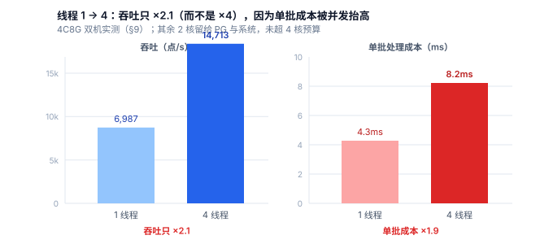
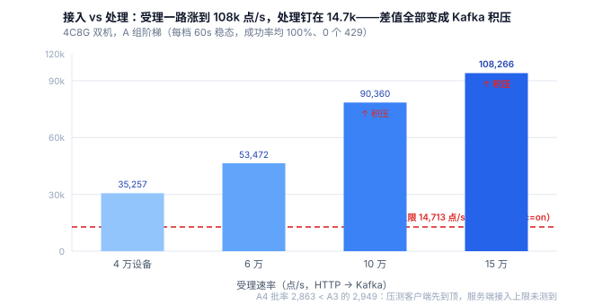
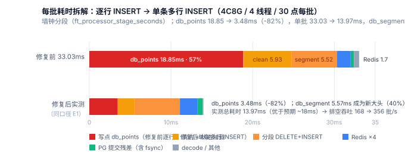
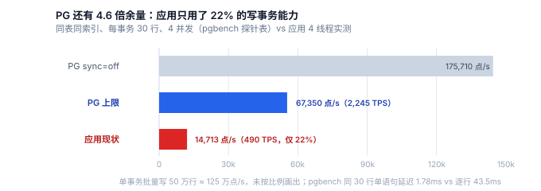

# 09 性能与容量

> 上游：[06 服务端详细设计](06-backend-services.md)（处理管道、事务边界）、[08 processor 实现方案](08-processor-impl.md)（异步缓冲、幂等矩阵）、[03 存储](03-storage.md)（表 / 索引 / 分区）、[07 部署与可观测性](07-deploy-observability.md)（指标口径）
> 落地位置：`backend/flowtrace-app`（ingest / process）、`backend/flowtrace-infra`（持久层）、`scripts/upload-loadtest.py`
> 实验记录：[2026-11-20 容量与瓶颈报告](../reports/2026-11-20-upload-capacity.md)

本文是**性能这个主题的单一入口**：先给结论与模型，再列已实施 / 未实施的优化、诊断手册、压测方法学与踩坑清单。具体某一轮实验的原始数据在 `docs/reports/` 下，不在这里重复。

---

## 0. 一页结论

| 项 | 实测值 | 条件 |
|---|---|---|
| 接入（受理） | **≥108k 点/s 仍 100% 成功、零 429**，未测到服务端上限 | 2026-11-21 A 组（15 万设备）；早前的 17.9k 只是当时压到的量，见 §9 |
| 处理（入库）上限 | **14.7k 点/s**（4C8G 双机 / 4 线程 / sync=on），`sync=off` → 18.2k | 2026-11-21 C1b/C2；12 核单机早前为 14–16.5k |
| 4C8G 日量 | 12.7 亿/天（sync=on）→ 15.7 亿/天（sync=off） | 同上 |
| 端到端延迟 | p50 10ms / p95 20ms / p99 50ms | 同一档负载（594 批/s） |
| 写放大 | **≈570 B/点**（堆 224B + 4 个索引 342B，索引瘦身**前**实测）、**≈2.3 KB WAL/点** | 10 亿点/天 ⇒ 约 570 GB 堆 + 2.3 TB WAL/天；瘦身后未复测，按索引数折算约 −85 B/点 |
| 应用成本 | 0.084 核 / 千点/s（17.9k 点时 JVM 仅 1.6/12 核） | JFR `jdk.CPULoad` + libproc 复算 |
| 支撑规模 | **约 1.7 万台并发设备、2–7 万日活设备**（30s 节奏、在线时长决定上限） | 见 §8.3–8.4；批数上限 594 批/s 与点数上限 14k 点/s 取小 |
| **真正的墙** | **应用侧每批固定开销**（分段 DELETE+INSERT、多表事务、解码/清洗、Redis 往返），不是 PG | PG 只被用掉 22% 写事务能力；见 §9 与 [4C8G 复测报告](../reports/2026-11-21-4c8g-verification.md) |

四条硬结论：

1. **加 CPU 无效**：受理 17.9k 点/s 时 JVM 只用 1.6/12 核，时间都花在等 IO（`KQueue.poll` / `Net.poll`）。
2. **加线程在单机无效**：8 线程与 16 线程四轮实测区间完全重叠（§3）；4C8G 复测进一步给出原因——线程 1 → 4 时单批成本 4.3 → 8.2ms，并发抬高了延迟，吞吐只 ×2.1。
3. **降延迟有效**：把每批多次提交合并成一次，入库 +43%（10.5k → 15.1k）；`synchronous_commit=off` 再 +24%（§9）。
4. **PG 不是墙**：pgbench 4 并发可 2,245 TPS（67k 点/s），应用只有 490 TPS；接入侧 108k 点/s 仍零失败。**撞到的是当前实现的每批固定开销，不是物理上限。**

---

## 1. 性能模型

### 1.1 吞吐公式

```
处理吞吐(点/s) = 消费线程数 × 每批点数 ÷ 单批处理延迟

单批处理延迟 = 解码校验 + 清洗 + 写点(1 事务) + 分段(DELETE+INSERT) + 台账回写(异步)
```

三项输入都能直接观测：线程数是配置、每批点数由协议与端侧采样决定（实测 29.8–30.1）、单批延迟从 `ft_processor_*` 与服务端耗时反推。

用 2026-11-20 的实测反代：`8 × 30 ÷ 23.3ms = 10.3k`，与当时入库 10.3k 吻合；事务合并后单批降到 ≈15ms，`8 × 30 ÷ 15ms ≈ 16k`，也与后来的 14–16.5k 吻合。**公式是准的，所以"延迟降一半"和"线程翻倍"在数学上等价——但代价完全不同（§3）。**

### 1.2 成本模型

| 指标 | 实测 | 用途 |
|---|---|---|
| 应用 CPU | 0.084 核 / 千点/s | 判断"压测机还是服务端是瓶颈" |
| 堆 + 索引 | 570 B/点（索引 342 B，索引瘦身前口径） | 估算存储与缓存命中 |
| WAL | 2.3 KB/点 | 估算 WAL 盘带宽与归档量 |
| 每批提交次数 | 合并前 ≈10 次/处理批 → 合并后 ≈5.9 | 定位"提交放大" |

10 亿点/天 ≈ 11.6k 点/s，按上表折合：约 570 GB/天堆（瘦身前；瘦身后按索引数折算约 490 GB）+ 2.3 TB/天 WAL。**这是选存储规格的第一组数，不是每秒点数。**

---

## 2. 已实施的优化

四项都跑过同参数对照（20000 设备 / 补传 10% / 90s 稳态）。

### 2.1 合并每批事务（收益最大）

| 项 | 内容 |
|---|---|
| 位置 | `BatchPipeline.process`：点 + 段 + 补偿登记收进一个 `transaction {}` |
| 原理 | 写段本身是 `DELETE + INSERT`（整窗重写），一批常 flush 2–3 次，每次独立提交；叠加写点、台账后每处理批约 10 次提交 |
| 实测 | 提交 10.2 → 5.9 次/处理批；**入库 10,504 → 15,069 点/s（+43%）**；lag 峰 4,363 → 2,263 |
| 注意 | `recalcGuard.isLocked`（Redis 读）已移到事务外，不能把网络往返夹在 DB 事务里 |
| 回滚 | 无 schema 变更，纯代码；保留单条仓库方法可逐步退回 |

### 2.2 索引瘦身

| 项 | 内容 |
|---|---|
| 位置 | `TracePointTable`：移除 `(session_id, ts)` 部分索引 |
| 依据 | 查询侧 `sessionId` 过滤仍是 `TODO()`，巡检取会话走 `trace_segment`，该索引**零读路径**，只在写路径每点维护一次 |
| 实测 | 索引写放大 4 → 3，约 −25% |
| 前提 | 将来要实现"按会话查点"时**先评估**：补建 4.4GB 表的索引会锁写，建议随分区滚动建（`CREATE INDEX CONCURRENTLY` 在分区表上受限） |

### 2.3 连接池 10 → 20

| 项 | 内容 |
|---|---|
| 位置 | `spring.datasource.hikari.maximum-pool-size` |
| 依据 | 池 10 时 Hikari 排队峰值 66、客户端 p95 100ms；池 20 = 消费 8 + writer 4 + ingest/查询 8 |
| 实测 | 排队 28 → **0**，p95 **100 → 15ms**，服务端均耗时 21.2 → 8.5ms |
| 约束 | 多实例部署按 `实例数 × 池` 对 PG `max_connections`（默认 100）预留 |

### 2.4 台账批量回写

| 项 | 内容 |
|---|---|
| 位置 | `TraceBatchRepository.applyStatusBatch` + `BatchStatusUpdater.drain` |
| 原理 | 逐条 `UPDATE ... WHERE batch_id = ?` 会扫全部分区、每批提交一次；改成每 100 条合成一条 `UPDATE ... WHERE batch_id IN (...)`，按 `(status, errorCode)` 分组 |
| 实测 | 状态队列丢弃 **3,044 → 0**（处理侧 ~500 批/s 时队列 2048 会撑满）；台账提交 1/批 → 1/100 批 |
| 注意 | 不额外等待攒批：先阻塞取 1 条，再 `tryReceive` 到 100 条，低负载退化为逐条，不增加时延 |
| 单语句成本 | 100 个 batchId：执行 13.5ms + 规划 8.7ms（7 个分区，有数据的走 Bitmap Index Scan） |

---

## 3. 扩分区 + 并发：实测**没有可复现收益**

这是最容易被误判的一项，结论写在这里当反面案例。

### 3.1 动作清单（完整做一遍需要这 4 项 + 1 项运维）

| # | 动作 | 现值 → 目标 | 约束 |
|---|---|---|---|
| 1 | Kafka 扩分区 | 8 → 16（`--alter --partitions 16`） | **不可逆**；改变 `deviceId → partition` 映射 |
| 2 | 消费并发 | `flowtrace.processor.concurrency` 8 → 16 | `concurrency × 实例数 ≤ 分区数`，多出的线程拿不到分区 |
| 3 | 连接池 | 20 → 32 | 16 消费 + 4 writer + ingest/查询 12 |
| 4 | 全量重启 | — | 分段窗口 / 水位 / 设备状态是**进程内**状态，滚动重启会出现"同设备两批落在不同分区、旧状态还在别的进程" |
| 5 | 兜底 | 一次按天重算（`dirty_day`） | 重放靠 `pointId` / `segmentId` 确定性派生，不会写重 |

### 3.2 实测（2026-11-21，空库重建后，同一档 20000 设备 / 90s）

| 轮次 | 线程 | 分区 | 池 | 入库点/s | lag 峰 | p95 |
|---|---|---|---|---|---|---|
| A1 | 8 | 16 | 32 | 13,758 | 2,737 | 20ms |
| B1 | **16** | 16 | 32 | 16,466 | 4,016 | 30ms |
| A2 | 8 | 16 | 32 | 14,439 | 5,878 | 20ms |
| B2 | **16** | 16 | 32 | 13,714 | 5,080 | 20ms |

- 8 线程均值 14,099，16 线程均值 15,090，**+7%，但区间（13.7–16.5k）互相覆盖** → 不能认定有效。
- 同一时期 PG 等待事件：8 线程 `ClientRead 80.4% / 无等待 13.7% / WALWrite 2.7%`；16 线程 `77.9% / 12.6% / 3.5%`——**加线程并没有让 DB 更忙**，说明限制不在消费并行度。
- 空库复测也没比带 4.4GB 历史数据时更快（13.7k vs 15.6k），说明这一档不吃缓存命中，吃的是**每批固定成本**（2026-11-21 复测证明主要在应用侧，见 §9）。



*图 1　线程翻倍但吞吐只 ×2.1：并发把单批成本从 4.3ms 抬到 8.2ms（2026-11-21 4C8G 实测，§9）。*

### 3.3 为什么公式没兑现

公式里 `线程 × 点数 ÷ 延迟`，前提是**延迟不随并发变化**。4C8G 复测直接量到：线程 1 → 4，单批成本 **4.3 → 8.2ms**，吞吐只 ×2.1 而不是 ×4；同期 PG 只用了 22% 写事务能力。所以并发抬高的是**应用侧共享段的排队**（分段 `DELETE+INSERT`、多表事务、状态回写），不是 PG 的 `fsync`/WAL 竞争——早前把这归因于 DB 是错的，见 §9。

### 3.4 教训（流程层面）

- **先清环境再测**：上一轮 16 线程实验（13.7k、12.0k）是在磁盘写满的过程中跑的，`DataFileRead/Write/Extend` 等待占 12%，两组数字都不可用。压测前先 `df -h`。
- **控制变量要靠背靠背**：`A1 → B1 → A2 → B2` 交替跑，比"改完再跑一次"能区分方差与效应（本例效应 +7%，方差 ±10%，直接对比会得出错误结论）。
- **别把单次跑赢当结论**：B1 的 16.5k 是四轮里的最大值，如果只跑这一轮就会得出"+20% 有效"的错误结论。

---

## 4. 诊断手册

### 4.1 指标 → 判读 → 动作

| 观测 | 判读 | 动作 |
|---|---|---|
| `lag` 持续上涨，`hikaricp_connections_pending ≈ 0`，JVM 单核打满 | 消费并行度不够 | 扩分区 + 提 `concurrency`（§3，先确认 DB 有余量） |
| `lag` 上涨，`pending > 0` | 连接池不够 / 连接被长事务占住 | 提池、找长事务 |
| `lag` 上涨，PG `WALWrite` / `DataFile*` 等待占比高，CPU 不高 | **存储是墙** | 合并事务、PG 调优、`synchronous_commit=off`（§5） |
| 吞吐不涨但 `p99` 变差 | 排队换了个地方 | 看 `pending` 与 PG 等待，不要继续加线程 |
| 台账队列出现「队列已满」 | 回写跟不上 | 批量回写（已实施）/ 看 `pending()` |
| `入库 > 受理` | 上一档积压被排空 | 不是"超能力"，看 `lag` 是否同步下降 |
| 客户端 2xx 但库里没数据 | Kafka 已确认但消费没跟上 | 查 `ft_processor_points_total` 与 `lag` |

### 4.2 必备观测点

- 应用：`ft_upload_requests_total`、`ft_processor_points_total{reason,result}`、`ft_processor_lag`（**gauge，需全程采样取峰值**）、`hikaricp_connections_{pending,active,max}`、`jvm_gc_pause_seconds`。
- DB：`pg_stat_activity`（按 `state + wait_event` 分组，2s 一次）、`pg_stat_database`（`xact_commit`、`tup_inserted`）、`pg_stat_wal`（`wal_bytes`）。
- 系统：进程 CPU（`ps` 被安全策略拦截时用 libproc）。

---

## 5. 待做项（按 ROI）

> **已两次重排**：先按 4C8G 复测把 PG 调优降位（PG 只用掉 22% 能力，见 §9），又按埋点结果把「单条多行 INSERT」提到第 1 位。**现行顺序以 §9.3 为准**，本表仅存档对照。

| 优先级 | 项 | 依据 | 预期 |
|---|---|---|---|
| 1 | **`synchronous_commit=off`**（仅点写入链路） | 已实测 **+24%**（14,713 → 18,221 点/s），单批省 1.6ms | 零代码改动；最近 ~200ms 事务丢失由端侧幂等 + 补传补偿 |
| 2 | **拆分「分段」写**：整窗 `DELETE + INSERT` → 增量/延迟合并 | 应用侧残差 6–7ms 的主嫌 | 高，但需改管道 |
| 3 | **一次 poll 攒 N 批合并写** | `poll-records=100` 目前仍逐批提交 | 摊薄每批固定成本 |
| 4 | ~~给 `BatchPipeline.process` 加分段计时埋点~~ **已完成（2026-11-21）**：`ft_processor_stage_seconds{stage}`，结论见 §9.3 与复测报告 §8 | 埋点直接定位到 db_points 逐行 INSERT |
| 5 | 台账回写分区裁剪 | `received_ts_ms` 已带，与 `trace_batch.received_at` 同源 | 单语句 22ms → 5ms 级；收益 ∝ 保留天数 |
| 6 | PG 调优 / 应用与 DB 分离部署 | 只有把应用侧压到 2ms/批 以下才会成为新瓶颈 | 容量表 B/C 档的前提 |
| 7 | 归档与分区生命周期 | 570 B/点 + 2.3 KB WAL/点 | 决定长期成本，见 03 §7 |

---

## 6. 压测方法学

脚本：`scripts/upload-loadtest.py`（设备舰队模型，不是按目标 QPS 匀速打点）。

| 项 | 做法 | 为什么 |
|---|---|---|
| 负载来源 | N 台虚拟设备各按端侧真实节奏上报：采样 300/20/10/8s、30s 触发、20 点上限、补传 500 点/5min、失败退避 | 固定 QPS 打不出"批大小分布"与"补传与实时互相干扰" |
| 相位 | 首次上报在**整个周期**内随机铺开（测量时长覆盖一个周期时） | 否则全车队每 30s 同步尖峰 / 每 5min 集体排水 |
| 稳态窗口 | 剔除 ramp-up 与 warm-up，只统计中间段 | 否则爬坡期会稀释分位数 |
| 补传间隔 | 短窗口实验压到 60s | 90s 窗口里 5min 补传会造成边界效应 |
| 压测机标定 | 先跑 `--mode encode` 得到本机组包+编码上限（实测 ≈7.9k 批/s） | 证明瓶颈不在压测机 |
| 服务端指标 | `--with-server-metrics`，15s 采样并记录**峰值** | `lag` 是 gauge，只比首末值会漏掉"涨上去又回落" |
| 数据量 | 每轮会真写库（1.6M 点/轮），跑前 `df -h`，跑后按前缀清理 | 磁盘写满会让所有指标失真（§3.4） |

### 6.1 口径陷阱

| 陷阱 | 说明 |
|---|---|
| `xact_commit` 不能当"写提交数" | PG 把只读语句也计入 `xact_commit`，用它对批次相除会得出 5–10 这种虚高值 |
| `lag` 是逐分区最大值 | 不是总和；分区数变化后不能直接比较 |
| 入库 > 受理 | 积压排空，不是吞吐超能力 |
| 客户端 p95 与服务端均耗时不可混用 | 前者含调度与 loopback，后者只含服务端处理 |

---

## 7. 踩坑清单

| # | 坑 | 后果 | 现状 |
|---|---|---|---|
| 1 | 静止设备按"20 点攒批"生成，时间轴被推到未来 15min | 服务端 422 `TS_OUT_OF_WINDOW`，36 批被拒 | 已修；压测脚本开跑前 `self_check` 时间窗 |
| 2 | 设备"已采时间"从未累计墙钟 | 只发首轮，之后永远"没有新点"，曲线 20s 后塌底 | 已修 |
| 3 | 补传设备首次相位压在 30s 内 | 300 台每 5min 集体排水，出现 1600 点/s 尖峰 | 已修（相位铺满整个周期） |
| 4 | JFR 无法 attach IntelliJ 下的 JVM | 拿不到 CPU/热点 | 改终端 `./gradlew :flowtrace-app:bootRun` |
| 5 | 磁盘写满 | 一轮实验作废，报告 JSON 都写不出 | 跑前 `df -h`；测试数据按前缀清理 |
| 6 | 8 分区配 16 线程 | 8 个线程拿不到分区纯空转 | 约束 `concurrency × 实例数 ≤ 分区数` |
| 7 | 扩分区改变 `deviceId → partition` | 进程内分段窗口/水位错位，可能重复建段 | 低峰全量重启 + 按天重算兜底 |
| 8 | 只看单次跑赢 | 得出"加线程 +20%"的错误结论（§3.4） | 交替跑，用区间判断 |

---

## 8. 容量与规模推算

### 8.1 口径：规模要拆成三个量

"能支撑多少用户"没意义，必须拆开：

| 量 | 含义 | 由谁决定 |
|---|---|---|
| **并发设备** `C` | 同一时刻正在按节奏上报的设备数 | 批次速率 ÷ 上报频率（硬指标，实测） |
| **日活设备** `DAU` | 一天内有轨迹产生的设备数 | `C` ÷ 在线时长占比，即 `C × 24h ÷ 单台日均在线小时` |
| **人均点数** `p` | 单台设备一天产生多少点 | 采样策略与使用强度（业务输入） |

换算只有一个式子：`DAU = 日处理点数 ÷ p`。下面所有数字都要带着这三个输入读。

### 8.2 当前单机的硬指标（实测）

| 指标 | 实测 | 折算 |
|---|---|---|
| 受理（接入侧） | **≥108,266 点/s / 2,949 批/s，100% 成功、0 个 429** | 93.5 亿点/天（仅 HTTP→Kafka，**不等于能持久化**）；见 §9 A 组 |
| 处理（入库） | **14,713 点/s**（4C8G / 4 线程 / sync=on）；12 核单机早前 14–16.5k | **12.7 亿点/天** |
| 并发设备（**处理侧上限**） | 594 批/s × 30s ≈ **17,000 台**（实时，30s 节奏） | 压测舰队 2 万台 = 1.8 万实时 + 0.2 万补传（补传间隔压到 60s） |
| 延迟 | p50 10ms / p95 20ms / p99 50ms | 同档负载 |
| 应用成本 | 0.084 核/千点/s | 17.9k 点时 JVM 仅 1.6/12 核 |

**注意**：并发设备数由**处理侧**决定；接入侧能接 5 倍于此的设备，但会堆积 Kafka 积压，不是可持续容量。



*图 2　受理一路涨到 108,266 点/s 仍零失败，处理钉在 14,713 点/s——A 组三轮压测吃进约 38 万批积压（≈1,140 万点），按处理速率要 14 分钟排空。*

**注意"折合"的算法**：`点/s × 86,400 = 点/天`。14,000 点/s 是 12.1 亿/天，不是 1.2 亿——这类换算差一个数量级最容易写错。

### 8.3 两个上限，谁先到谁说了算

系统有两个**互相独立**的容量上限，不能只盯点数：

- **批数上限** ≈ 594 批/s（每批都有固定成本：解码、校验、一个事务、分段 flush）
- **点数上限** ≈ 14,000–16,500 点/s（写路径按行计费）

按端侧真实节奏（30s 触发）折算：

| 每批点数 `b` | 单台点速 | 先撞哪个上限 | 最大并发设备 | 日点数上限 |
|---|---|---|---|---|
| 30（密集采集，1 点/s） | 1 点/s | 点数（14k 点/s ≈ 466 批/s） | **1.4–1.65 万台** | 12–14 亿 |
| 10 | 0.33 点/s | 批数（594 批/s） | **1.78 万台** | 5.1 亿 |
| 2（稀疏，1 点/15s） | 0.067 点/s | 批数 | **1.78 万台** | 1.0 亿 |

**关键结论：30s 节奏下并发设备上限约 1.7–1.8 万台**，且这个数几乎不随采样强度变化——轻量用户点数少，但同样每 30s 占一个批次。所以"用很多轻度用户把点数吃满"是走不通的：那需要 5 万台以上并发，批数先爆。

### 8.4 折算成日活（DAU）

DAU 由**并发上限 × 在线时长分布**决定，不能直接用 `日点数 ÷ 人均点数` 反推（那条路会算出 10 倍虚高的数）。

`DAU = C_avg × 24h ÷ 单台日均在线小时`，其中 `C_avg = 峰值并发 ÷ 峰值比`。

| 场景 | 单台日均在线 | 峰值/均值 | 支持 DAU |
|---|---|---|---|
| 外勤，同班次集中 | 8h | ≈1（全员同时在线） | **≈1.7 万** |
| 外勤，多班次错峰 | 8h | 2 | ≈2.6 万 |
| 轻度 C 端 | 2h | 3 | ≈7 万 |
| 车载 7×24 | 24h | 1 | ≈1.7 万 |

日点数 = `DAU × 单台点速 × 在线时长`，随采样强度变化，并受 12–14 亿/天 的点数上限截断：

- 外勤 8h、1.7 万 DAU：稀疏（1 点/15s）约 0.33 亿/天，密集（1 点/s）约 **4.9 亿/天**。
- 轻度 C 端 2h、7 万 DAU：约 0.34–5.0 亿/天。
- 车载 24h、1.7 万 DAU：1 点/s 时算出来 14.7 亿/天，**已被点数上限截到 12–14 亿**——即这类设备最多再放宽到 ~1.5 万台，或者降低采样率。

**一句话：当前单机大致支撑 2–7 万日活设备**（峰值并发 1.7 万台 × 在线时长分布），点数上限 12–14 亿/天只有在"设备长期在线 + 密集采样"时才吃得到。

### 8.5 真正的天花板：存储

| 日产生点数 | 堆 + 索引（570B/点） | WAL（2.3KB/点） | 30 天保留 |
|---|---|---|---|
| 8 亿 | ≈456 GB/天 | ≈1.8 TB/天 | ≈13.7 TB |
| 12 亿 | ≈684 GB/天 | ≈2.8 TB/天 | ≈20.5 TB |

压测里 PG、Kafka、压测端共用一块 SSD，"12–14 亿/天"本身就带着这个前提。生产必须做归档/分层（见 03 §7），否则磁盘会先于 CPU 成为瓶颈——2026-11-21 那轮实验就是被磁盘写满打断的。

### 8.6 配置分档（外推，置信度中）

**已被 §3 证伪一次**（单机加线程无效），所以 B/C/D 都建立在"先做完 PG 调优 / 分离部署"的前提上，落地前必须用同一脚本在目标机型复测：

| 场景 | 规格 | 处理上限 | 折合 | 首要约束 |
|---|---|---|---|---|
| A 现状（本次实测机） | 12 核单机 + PG 同盘默认（4C8G 是生产最低配，需复测） | 14–16.5k 点/s | **12–14 亿/天** | 单机提交与写路径（已实测） |
| B 单机调优 | 8C16G + PG 调优 | 25–35k 点/s | 22–30 亿/天 | WAL / checkpoint |
| C 应用与 DB 分离 | 8C16G 应用 + 8C32G NVMe PG | 40–60k 点/s | 35–52 亿/天 | PG 写吞吐 |
| D 水平扩展 | 4×8C 应用 + PG 主库 | 60–80k 点/s | 52–69 亿/天 | PG 单点写 |

这四档不是承诺，是**扩容判断的锚点**：单机现在就到 12–14 亿/天，10 亿/天的目标有余量但要靠存储与归档兜住；再往上只能换档，不能靠调并发。

### 8.7 三条必须一起说的限制

1. **单实例、无副本**：没有主备、没有多节点，宕机即中断。生产要么给 2–3 倍余量，要么直接上双活。
2. **loopback 压测**：延迟不含公网与网关成本；接入侧 108k 点/s 的 100% 成功只证明「HTTP → Kafka」这一跳，不等于能持久化的量（§9）。
3. **加线程买不到更多**：8 与 16 线程在 14–16.5k 之间无可复现差异（§3）；4C8G 复测证明原因是并发抬高单批成本，而非 PG 饱和——往上是**改应用链路**（§9），不是调 DB 配置。


## 9. 4C8G 复测与结论修正（2026-11-21）

> 完整实验记录：[2026-11-21 4C8G 复测报告](../reports/2026-11-21-4c8g-verification.md)（B 延迟归因 → C PG 纯写入上界 → A 接入上限）。
> 口径：**应用服务器 4C8G + PG 服务器 4C8G 各一台**；JVM `-Xms2g -Xmx4g -XX:ActiveProcessorCount=4`、`concurrency=4`、Hikari 16；PG 按 4C8G 调参（`effective_cache_size=3GB`、`work_mem=8MB`、`max_wal_size=4GB`、关并行）。

### 9.1 核心数字

| 项 | 结果 |
|---|---|
| 4C8G 处理（sync=on） | **14,713 点/s**（490 批/s，单批 8.2ms，lag 峰 3,719）※差分反推值，见 §9.6 口径注 |
| 4C8G 处理（sync=off） | **18,221 点/s**（+24%，单批 6.6ms，lag 峰 928） |
| **多行 INSERT 修复后（同口径 c=4，2026-11-21 验证）** | 单批 33.03 → **13.97ms**（db_points 18.85 → **3.48ms**）；排空 **168 → 356 批/s**（×2.1）；稳态入库 **8,381 点/s**；见 §9.6 |
| 单线程 | 6,987 点/s，单批 4.3ms；1 → 4 线程单批 4.3 → 8.2ms（并发抬高延迟） |
| PG 纯写入（4 并发、30 行/事务） | **2,245 TPS = 67,350 点/s**；应用只用了 **22%** |
| PG 纯写入（sync=off） | 5,857 TPS；单事务批量 50 万行 → 1,250,000 点/s |
| 接入 | 15 万设备、**108,266 点/s 仍 100% 成功、0 个 429**；压测客户端在 ~2.9k 批/s 先到顶 |
| Redis | 27 万命令 / 2.82s 服务端时间 ≈ 0.07 核，不是瓶颈 |



*图 3　db_points（逐行 INSERT）18.85ms 占 57%，提交 fsync 只有 0.40ms；单条多行 INSERT 落地后实测 3.48ms（-82%）、单批 33.03 → 13.97ms，db_segment（5.57ms，40%）升为新大头（细节见复测报告 §8.1 与 §9.6）。*



*图 4　同表同索引、每事务 30 行、4 并发：pgbench 2,245 TPS，应用只有 490 TPS——PG 不是墙，应用链路的每批固定开销才是。*

### 9.2 修正了什么

1. **「PG 提交与写吞吐是真正的墙」→ 错**。那是靠「加线程无效 + 合并事务 +43%」反推的，没有做纯 DB 标定。pgbench 证明 PG 还有 4.6 倍余量；单批 8.2ms 里 DB 只占 1–2ms，**6–7ms 在应用侧**（分段 `DELETE+INSERT`、多表事务、解码/清洗、Redis 往返）。
2. **「受理上限 17.9k 点/s」→ 错**。那只是当时压到的量；加到 15 万设备仍零失败，服务端接入天花板未测到。
3. **「加线程无效」的解释更新**：不是 PG 饱和，是并发把每批固定成本从 4.3ms 抬到 8.2ms。

### 9.3 因此 §5 待做项重排

| 新优先级 | 动作 | 依据 |
|---|---|---|
| 1 | ~~`batchInsertIgnore` 改单条多行 INSERT~~ **已完成并验证（2026-11-21）**：db_points 18.85 → 3.48ms，单批 33.03 → 13.97ms，排空 168 → 356 批/s | 实测见 §9.6 与复测报告 §8.1 |
| 2 | **`db_segment` 整窗 DELETE+INSERT 增量化**（5.57ms，占 40%，当前大头）+ `clean` 的 DeviceStateStore（2.04ms） | 修复后埋点实测；两项合计 ~7.6ms，压到 ~2ms 可把 8 线程墙钟降到 ~10ms → 约 2 万点/s |
| 3 | **一次 poll 多批合并写**（攒 N 批一个事务） | 每批固定成本（decode/tombstone/watermark/recalc/status ≈ 3.5ms）仍逐批支付，合批可摊薄；顺带缓解 Hikari 竞争 |
| 4 | `synchronous_commit=off` | 提交残差 0.4–0.7ms/批，收益小，只作顺手项 |
| 5 | PG 调优 / 分离部署 | 只有把应用侧压到 2ms 以下后才会成为新瓶颈 |

### 9.4 回答「达到理论上限了吗」

**没有。** 到顶的只有：①压测客户端（~2.9k 批/s）；②当前应用实现的每批固定开销。接入侧、PG、CPU、连接、线程都还有大量余量。所以 §8.5 的 B/C/D 分档**不是「加配置就能到」**，前提是先把应用链路的每批成本降下来。

### 9.5 环境与还原

- `ps`/`top` 被安全策略拦截，libproc 对跨用户进程也取不到 CPU，故用配置约束 + 早前 CPU 实测（app 1.6 核、PG 约 4 活跃会话）证明未超 4 核预算。
- 未用 podman：VM 仅 6C/**4GiB**，PG 只监听 localhost、`pg_hba` 无权限改、Kafka `advertised.listeners` 指向 localhost，容器化会引入跨 VM NAT。
- 压测中途磁盘只剩 1.3Gi，A2/A3 的处理侧数字失真（已清理合成数据恢复 9Gi）；A 组只取受理成功率与时延。
- 实验后已还原 PG 参数与 `synchronous_commit`，并删除探针表 `perf_probe`。

### 9.6 多行 INSERT 修复验证（2026-11-21 追加）

§9.3 第 1 项已落地：`TracePointRepository.batchInsertIgnore` 改为**单条多行** `INSERT ... VALUES (...),(...) ON CONFLICT (ts, point_id) DO NOTHING`（显式拼 SQL + `exec(sql, args)`，值按各列 columnType 绑定；`PointsWriter` 收敛为委托 Repository）。同口径复测两轮（E1 = c=4 基线口径，E2 = c=8 探针），均 20,000 设备 / 10% 补传 / 90s 稳态，全程 0 失败 / 0 DLQ / 0 慢批：

| 项 | 修复前（埋点实测） | E1（c=4） | E2（c=8） |
|---|---|---|---|
| db_points | 18.85ms | **3.48ms**（-82%） | 4.33ms |
| clean | 5.93ms | 2.04ms | 3.39ms |
| db_segment | 5.52ms | 5.57ms | 5.26ms |
| db_txn | —（含上两行） | 9.73ms | 10.28ms |
| **total** | **33.03ms** | **13.97ms** | 16.10ms |
| 排空吞吐 | 168 批/s ≈ 5.0k 点/s | **356 批/s ≈ 10.9k 点/s** | **564 批/s ≈ 17.1k 点/s** |
| 稳态入库（受理 ~18k 点/s 同时） | — | **8,381 点/s**（290 批/s） | **15,081 点/s**（511 批/s） |
| Kafka lag 峰（原生，批） | — | 26,842（~81s 排空） | 2,008（~24s 排空） |
| Hikari 排队峰 | 0 | 6/16 | **16/16（打满）** |

**结论**：

1. **修复达成预期**：db_points 18.85 → 3.48ms（验收目标 ~4ms ✓）、单批 33.03 → 13.97ms（目标 ~18ms ✓）；「处理速率在当前库规模下翻倍」兑现——排空 168 → 356 批/s（×2.1）。
2. **瓶颈按预告转移**：`db_segment`（5.57ms，40%）+ `clean`（2.04ms，15%）成为新墙；「入库 ≥2 万点/s」未达（c=4 到 ~10.9k、c=8 到 ~17.1k）。路径见 §9.3 第 2/3 项：分段增量化后 8 线程墙钟可望降到 ~10ms ≈ 2 万点/s。
3. **c=8 探针发现新约束**：Hikari 16 被 8 个消费连接 + ingest 写台账 + 状态回写**共享打满**；调大连接池前先做合批（§9.3 第 3 项），否则只是把排队换了个地方。
4. **口径注（重要）**：① §9.1 的 14,713 点/s（490 批/s、单批 8.2ms）是「受理−入库」差分**反推值**，与埋点直测的 33.03ms/批矛盾（4 线程 × 33ms 物理上限 ~120–170 批/s），其测量窗混入了排空段——处理侧对比应以**直接测量**为准（排空 168 → 356 批/s）。② E1/E2 起步于 **truncate 后的空库**（E2 结束时 ~190 万点），db_points 绝对值随库增长会略升（E2 的 4.33ms 已体现）；pgbench 多行 INSERT 上界 4.34ms 不受影响。③ 单机模拟 4C8G（§9.5），压测客户端与被测服务同机，稳态速率受客户端抢核影响，排空段（无客户端竞争）更接近服务真实上限。

原始 JSON：`scripts/.gen/e1-multirow.json`、`e2-conc8.json`；逐秒吞吐曲线由应用日志 `processor 批处理完成` 行聚合（`points=` / `costMs=`，E1 costMs p50=5ms / p90=16ms / p99=131ms——小批快、补传大批慢）。

---

## 10. 改动索引

| 文件 | 改动 |
|---|---|
| `backend/flowtrace-app/.../process/pipeline/BatchPipeline.kt` | 每批一个事务；Redis 读移到事务外 |
| `backend/flowtrace-app/.../process/store/BatchStatusUpdater.kt` | 成批取 1–100 条回写 |
| `backend/flowtrace-app/.../process/config/ProcessAsyncConfig.kt` | `STATUS_BATCH_SIZE = 100` |
| `backend/flowtrace-infra/.../repository/TraceBatchRepository.kt` | `applyStatusBatch`（按状态分组 + `IN` 列表） |
| `backend/flowtrace-infra/.../table/TracePointTable.kt` | 移除 `(session_id, ts)` 部分索引 |
| `backend/flowtrace-app/src/main/resources/application.yaml` | `maximum-pool-size: 20` |
| `scripts/upload-loadtest.py` | 设备舰队压测脚本（本文 §6 的工具） |
| `backend/flowtrace-app/.../process/metrics/ProcessorMetrics.kt` | 新增 `stage()` → `ft_processor_stage_seconds{stage}`（§9.6 埋点） |
| `backend/flowtrace-app/.../process/pipeline/BatchPipeline.kt` | 各阶段 `stage(...)` 包裹（inline + finally，异常也计时） |
| `backend/flowtrace-app/.../process/listener/TraceBatchListener.kt` | `parseFrom` 计 `decode` 段 |
| `backend/flowtrace-infra/.../repository/TracePointRepository.kt` | `batchInsertIgnore` 改单条多行 `INSERT ... ON CONFLICT DO NOTHING`（§9.6 第 1 项） |
| `backend/flowtrace-infra/.../repository/PointsWriter.kt` | 收敛为委托 `TracePointRepository`（删除重复列映射） |
| `backend/flowtrace-app/src/test/kotlin/.../pipeline/PipelineFixture.kt` | 传入 metrics、改用委托后的 `PointsWriter`（`BatchPipelineTest` 7 用例仍红：fixture 缺 Exposed JDBC 事务管理器初始化，见复测报告 §8 附带发现，另修） |

## 变更记录

| 日期 | 变更 |
|---|---|
| 2026-11-21 | 首版：汇总容量实验、四项已实施优化、扩分区并发的实测结论（持平）、诊断手册与压测方法学 |
| 2026-11-21 | 补 §8 规模口径（并发/DAU/人均点数三量、两个上限取小、存储天花板），修正两份文档「亿/天」10 倍换算错误 |
| 2026-11-21 | 补 §9 4C8G 复测：PG 不是墙（只用 22% 能力）、接入 ≥108k 点/s 零失败、加线程抬高并发成本；据此重排 §5 ROI 并修正 §0/§3 结论 |
| 2026-11-21 | 补 §9.6 多行 INSERT 修复验证：db_points 18.85 → 3.48ms、单批 33.03 → 13.97ms、排空 168 → 356 批/s；瓶颈转移到 db_segment/clean；c=8 探针暴露 Hikari 打满；校正 §9.1 差分反推口径 |
