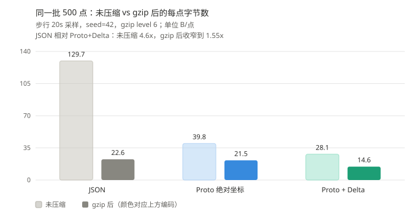
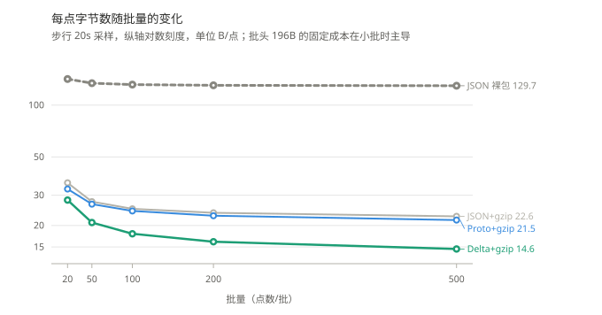

# 轨迹上报编码与压缩效果报告

> 日期：2026-11-20　范围：`proto/trace.proto` 上报链路（JSON / Protobuf / Protobuf+Delta，含 gzip）
> 结论一句话：**gzip 之后，Proto 相对 JSON 只剩 1.05 倍，真正把差距拉开的是 Delta（合计 1.55 倍）；而 Delta 的收益也只在配合 gzip 时才成立。**

## 0. 摘要

| # | 结论 |
|---|---|
| 1 | 裸传时 JSON→Proto 有 3.3x 收益（129.7 → 39.8 B/点），但**开了 gzip 几乎归零**（22.6 → 21.5，仅 1.05x）。「Proto 省 3 倍」只在无压缩时成立。 |
| 2 | **未压缩时 Delta 反而更大**（200 点：7969B 绝对 vs 8169B Delta）。根因是 `d_lat`/`d_lng` 写成 `int32`，负数被符号扩展成 10 字节 varint，而 92% 的轨迹点至少有一个分量为负。 |
| 3 | 修成 `sint64`（zigzag）后：未压缩 **−30%**，gzip 后 −4~6%。 |
| 4 | **Delta 的真实价值在 gzip 之后**：比「绝对坐标 + gzip」再省 **27~29%**（200 点 4555B → 3214B）。 |
| 5 | 20 点实时批被 196B 的批头（两个不可压 UUID）拖累，压缩比只有 5.0x；批头里 `device_id`/`user_id` 与网关头语义重复，是可省的冗余。 |

最终形态（500 点驾车批）：**65.2KB JSON → 13.2KB 裸 Proto+Delta → 7.6KB gzip 后**，即每点 15.6 字节，相对 JSON 裸包 8.4 倍。

## 1. 测试方法

| 项 | 取值 |
|---|---|
| 轨迹生成 | 直接用 `scripts/gen-and-upload.py` 的 `TrackSimulator`（航向随机游走 + 速度涨落 + 偶发停车），seed=42，起点北京 39.9042/116.4074 |
| 每点字段 | `ts / lat / lng / accuracy(400~2500cm) / speed / bearing / altitude(30~60m，±60cm 抖动) / source`，与真实上报同构 |
| 编码变体 | ① 常规 JSON（绝对坐标、语义字段名，度为单位）② Proto 绝对坐标（`trace_message.proto` 的 `AbsolutePoint`）③ Proto + Delta（`trace.proto`，批头 base + 链式增量） |
| 压缩 | 每种变体各测压缩前/后；`gzip.compress(level=6, mtime=0)`，与 SDK 约定一致 |
| 可变项控制 | `client_ts_ms` 固定为 1750000000000，批头 UUID 固定 —— 否则每轮 ±1B 抖动，无法逐字节对齐 |
| 场景 | 静止 30s、步行 20s、驾车 8s 三种采样节奏；20 / 50 / 200 / 500 点四种批量 |

## 2. 结果



*图 1　未压缩时 JSON 与 Proto+Delta 差 4.6x，gzip 后收窄到 1.55x；而 Proto 绝对坐标在 gzip 后与 JSON 基本持平（21.5 vs 22.6）。*

### 2.1 结果总表（字节）

| 场景 | 点数 | JSON | JSON+gz | Proto 绝对 | Proto+gz | ProtoΔ(int32) | Δ+gz | **ProtoΔ(sint64)** | **Δ+gz** |
|---|---|---|---|---|---|---|---|---|---|
| 静止 30s | 20 | 2841 | 704 | 907 | 640 | 1036 | 576 | **734** | **551** |
| 步行 20s | 20 | 2836 | 708 | 907 | 652 | 1045 | 591 | **741** | **563** |
| 步行 20s | 50 | 6707 | 1376 | 2077 | 1328 | 2333 | 1103 | **1578** | **1041** |
| 步行 20s | 200 | 26086 | 4748 | 7969 | 4555 | 8169 | 3418 | **5736** | **3214** |
| 驾车 8s | 50 | 6742 | 1426 | 2067 | 1324 | 2262 | 1109 | **1532** | **1073** |
| 驾车 8s | 500 | 65197 | 11754 | 19778 | 10755 | 19256 | 8128 | **13509** | **7806** |

### 2.2 每点成本与压缩比

（sint64 + gzip 后）

| 场景 | 点数 | B/点 | 相对 JSON 裸包 | 相对 JSON+gzip |
|---|---|---|---|---|
| 静止 30s | 20 | 27.6 | 5.2x | 1.28x |
| 步行 20s | 20 | 28.1 | 5.0x | 1.26x |
| 步行 20s | 50 | 20.8 | 6.4x | 1.32x |
| 步行 20s | 200 | 16.1 | 8.1x | 1.48x |
| 驾车 8s | 50 | 21.5 | 6.3x | 1.33x |
| 驾车 8s | 500 | 15.6 | 8.4x | 1.51x |

## 3. 四个发现

### 3.1 「Proto 省 3 倍」在开压缩后不成立

未压缩：JSON 129.7 B/点 → Proto 39.8 B/点（3.3x），这是去字段名 + 整数化坐标的收益。
加 gzip：22.6 B/点 → 21.5 B/点（**1.05x**）。gzip 已经把 JSON 里的数字文本吃掉大半，重复的字段名也被字典化 —— Proto 省下的那部分，恰好是 gzip 最擅长消掉的部分。驾车批（speed/bearing/altitude 抖动更大）能到 1.09x，但量级一样。

**含义**：如果用 Proto 只是为了省带宽，而链路本来就 gzip，那这笔账只有 1.05~1.1 倍。真正值得做 Proto 的理由是 schema 演进（字段号+向后兼容）、跨语言强类型、以及给 Delta 提供载体。

### 3.2 Delta 在未压缩时反而更大（int32 的符号扩展陷阱）

200 点步行批：绝对坐标 7969B，Delta 8169B —— **Delta 更胖**。

根因在 proto3 编码：`int32` 的负值不做 zigzag，而是符号扩展到 64 位再 varint，固定占 **10 字节**。轨迹增量约 **92%** 的点至少有一个分量为负（航向往西/南），于是每点白扔 8~16 字节，抵消了增量本身「数值小」的优势。

改成 `sint64`（zigzag）后：

| 场景 | 点数 | int32 未压缩 | sint64 未压缩 | 降幅 | int32 gzip | sint64 gzip | 降幅 |
|---|---|---|---|---|---|---|---|
| 静止 30s | 20 | 1036 | 734 | 29.2% | 576 | 551 | 4.3% |
| 步行 20s | 20 | 1045 | 741 | 29.1% | 591 | 563 | 4.7% |
| 步行 20s | 50 | 2333 | 1578 | 32.4% | 1103 | 1041 | 5.6% |
| 步行 20s | 200 | 8169 | 5736 | 29.8% | 3418 | 3214 | 6.0% |
| 驾车 8s | 50 | 2262 | 1532 | 32.3% | 1109 | 1073 | 3.2% |
| 驾车 8s | 500 | 19256 | 13509 | 29.8% | 8128 | 7806 | 4.0% |

未压缩省 ~30%，gzip 后只剩 4~6% —— 因为符号扩展产生的重复零字节，本来就极好压。**所以这个改动的正当性在「未压缩的那一跳」（编码、内存、抓包、Kafka 前的中间态），而不是带宽。**

### 3.3 Delta 的真实价值：给 gzip 喂更可压的数据

| 场景 | 绝对坐标+gzip | Delta+gzip | 差值 |
|---|---|---|---|
| 步行 20 点 | 652 | 563 | −13.6% |
| 步行 50 点 | 1328 | 1041 | −21.6% |
| 步行 200 点 | 4555 | 3214 | **−29.4%** |
| 驾车 500 点 | 10755 | 7806 | **−27.4%** |

绝对值序列里，高位字节在每点都重复但低位随机（精度噪声），LZ77 能吃到一部分；Delta 序列则是「同量级小整数 + 高位大段 0」，重复模式更整齐。**结论：Delta 与 gzip 是配套的两件事，只用其一都拿不到数量级收益。**

### 3.4 小批实时通道由批头主导



*图 2　批量越小，每条曲线的每点成本越高：20 点批时 JSON+gzip、Proto+gzip、Delta+gzip 挤在 28~35B，到 500 点批才拉开到 22.6 / 21.5 / 14.6。差距被放大的部分正是被批头摊薄的部分。*

批头固定 **196B**（`batchId` + `sessionId` 两个 36 字符 UUID 占 ~72B，且随机不可压）。20 点批里它占未压缩载荷 **26%**，500 点批只占 1.4%。

这也是实时批压缩比只有 5.0x、补传批能到 8.4x 的主要原因 —— 不是编码效率变差，是分母里掺了不可压的固定成本。

另外 `header.device_id` / `header.user_id` 与网关注入的 `X-Device-Id` / `X-User-Id` 语义完全重复（协议注释本身就写着「必须与 token 声明一致」），20 点批里是 ~30B 的纯冗余，**比 sint64 在 gzip 后的收益还大**。

## 4. sint64 纠偏：一次「静默错值」型改动

### 4.1 问题不是新引入的，是 proto 漂移

| 位置 | 实际类型 | 判定 |
|---|---|---|
| `docs/design/02-protocol.md` §2/§3 | `sint64` | 设计意图（并写明了原因） |
| `sdk/.../generated/trace_pb.ts` | `bigint`（= sint64） | 与设计一致 |
| `proto/trace.proto` | `int32` | **漂移源**，自首次提交起就是 int32 |
| 后端 Kotlin（由 proto 生成） | `Int` | 跟着漂 |

因当时无存量客户端，按设计稿一次性改回 `sint64`，三端重新对齐。

### 4.2 为什么不能「先发再说」：双向静默错值

`int32` 与 `sint32`/`sint64` 的 wire type 同为 varint，字节流能读通、不抛异常，但值全错：

| 原始 delta | 旧端（int32）读 sint 包 | 新端（sint）读 int32 包 |
|---|---|---|
| 2335 | 4670（+26 m） | -1168（−39 m） |
| -2335 | 4669（+78 m） | **-2147482481**（错飞 2.4 万 km） |
| -26 | 51（+83 m） | **2147483635** |

两个方向的错法不同：新端读旧包时，正数被当 zigzag 解成约 `v/2`；负数的 10 字节 varint 解完再截断成 int32，会溢出成 `±2^31` 量级。而 Delta 是**链式累积**的 —— 错一个点，后面整批全错，且没有任何异常、日志或校验会报警。

这也解释了为什么此前所有测试都是绿的：字段级往返测试自洽，只有**字节数**和**跨实现的固定 fixture** 才看得出来。

### 4.3 防复发

新增 `backend/flowtrace-domain/src/test/.../DeltaEncodingSizeTest.kt`，钉死四件事：

- 单点（`d_ts=20000, d_lat=-2335, d_lng=2335`）序列化 = **10 字节**（int32 会变 18）
- `GeoBase` 负坐标（南半球 + 西经） = **19 字节**（int32 会变 29）
- 固定 wire fixture `08 c0 b8 02 10 bd 24 18 be 24` 解出 `(20000, -2335, 2335)`，充当跨语言契约
- 批内每点固定开销 = **12 字节**（10 + repeated tag/长度）

只要字段类型退回 32 位、或字段号挪位，这些用例立刻红。

## 5. 顺带修掉的一个独立漏洞

`BatchValidator` 判坐标越界原用 `abs(point.latQ) > MAX_LAT_Q`。但 `abs(Int.MIN_VALUE)` 溢出后仍是负数，而 `-2147483648 > 900000000` 为 `false` —— 极端负坐标能**漏过 `INVALID_COORD`**，一路写进 Kafka 与数据库。

改为四段范围比较（不做 abs），并新增用例 `极端负增量同样不回绕成假合法坐标`。这个洞在 int32 时代就存在（2 个 `Int.MIN_VALUE` 增量即可触发），sint64 只是让它更容易构造。

## 6. 落地改动

| 文件 | 改动 |
|---|---|
| `proto/trace.proto` | `lat_q` / `lng_q` / `d_lat` / `d_lng`：`int32` → `sint64`，并注释说明原因与实测数字 |
| `backend/flowtrace-domain/.../delta/DeltaBatchDecoder.kt` | 累加天然按 Long，去掉冗余 `.toLong()` |
| `backend/flowtrace-domain/.../validation/BatchValidator.kt` | 坐标越界判断去掉 `abs` 溢出漏洞 |
| `backend/flowtrace-domain/.../DeltaEncodingSizeTest.kt` | 新增：字节数与 wire fixture 守护（4 用例） |
| `backend/flowtrace-domain/.../DeltaBatchDecoderTest.kt` | Long 适配 + 新增极端负增量用例 |
| `backend/flowtrace-app/.../TraceUploadControllerFlowTest.kt` | Long 适配 |
| `sdk/.../generated/trace_pb.ts` | `yarn proto:generate` 重生成；顺带修正 `flowtrace.v1` → `dev.yidafu.flowtrace.v1` 的旧注释漂移 |
| `docs/design/02-protocol.md` | §2 补纠偏记录（注明属未上线前的一次例外）；§5 估算表换成实测表 |

验证：`./gradlew build` 通过；`./gradlew test --rerun-tasks` **26 个测试类 / 170 用例全绿**；`ktlintCheck` 通过；`yarn proto:generate && yarn typecheck` 通过；`python3 scripts/gen-and-upload.py --points 20 --dry-run` 用新 proto 跑通（raw 713B / body 568B）。

## 7. 遗留与建议

| 事项 | 判断 |
|---|---|
| `trace_message.proto` 的 `AbsolutePoint.lat_q/lng_q` 仍是 `int32` | **暂不改**。国内经纬度全为正，与 sint64 编码后同为 5 字节；且它直接映射 DB `integer` 列，改动要连带 migration。出海到西经/南半球时按 02 §1 走 `trace.batch.v2`。 |
| 批头的 `device_id` / `user_id` 冗余 | **建议做**。服务端先改成「header 为空则取网关头，非空则校验一致」，老 SDK 行为不变；SDK 下版停填。20 点批省 ~30B（5%），且完全向后兼容。 |
| 继续抠编码（更极端的量化、位打包） | **不建议**。gzip 后已到 15.6 B/点，继续优化的对象应是批头固定成本，而非点数据。 |
| 解码侧轨迹合理性校验（相邻点位移 vs 速度上限） | **建议补**。这是防「静默错值」这类 bug 的通用兜底，能覆盖任何未来的协议实现错误。 |

## 附录：复现

```bash
# 1. 生成 Python 侧 protobuf 模块（含 int32 / sint64 两个版本用于对照）
protoc -Iproto --python_out=<dir> proto/trace.proto proto/trace_message.proto

# 2. 压缩效果对照：复用仓库内的轨迹模拟器，保证与真实上报同构
#    场景/批量/压缩级别见 §1；脚本见本次分析所用的 bench（未入库）

# 3. 字节数守护（CI 常驻）
cd backend && ./gradlew :flowtrace-domain:test --tests "*DeltaEncodingSizeTest*"
```
