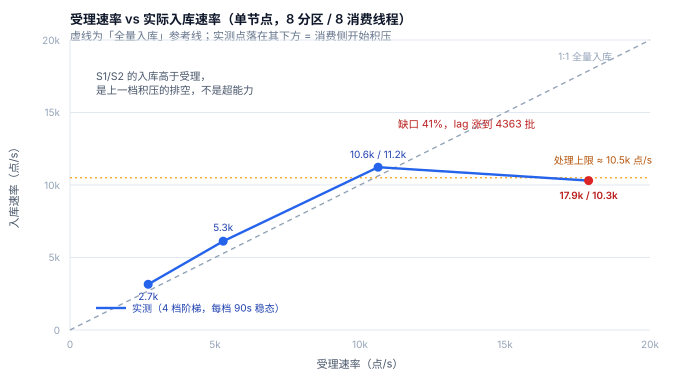

# 轨迹上报容量与瓶颈报告

> 日期：2026-11-20　范围：`POST /v1/traces/batch` → Kafka → processor → PostgreSQL（单节点，单体应用）
> 结论一句话：**瓶颈不在应用 CPU（峰值只用 1.6/12 核），而在 PostgreSQL 的「每批提交 + WAL 刷盘」——受理侧能扛 17.9k 点/s 且 100% 成功，处理侧到 10.3k 点/s 就追不上了。** 已实施三项改动（合并事务、池 10→20、台账批量回写）后，处理侧抬到 **15.6k 点/s**，Hikari 排队与台账队列丢弃都归零。

## 0. 摘要

| # | 结论 | 证据 |
|---|---|---|
| 1 | 单节点**处理上限 ≈ 10.3k 点/s（8.9 亿点/天）**；受理当时压到 17.9k 点/s（15.4 亿/天），两者差 41% 就是消费侧的缺口 ⚠️ **「受理上限」与「PG 是墙」已在 [2026-11-21 4C8G 复测](2026-11-21-4c8g-verification.md) 中被更正** | 阶梯压测：受理 17,883 点/s 时入库仅 10,300 点/s，lag 涨到 4363 批 |
| 2 | **应用侧远不是瓶颈**：17.9k 点/s 时 JVM 只占 1.6/12 核（12.6%） | JFR `jdk.CPULoad` 均值 + libproc 独立复算（1.51 vs 1.67 核） |
| 3 | JVM 的时间几乎都花在**等 IO** 上，不是算 | 原生帧 top：`KQueue.poll` 13,907、`Net.poll` 7,174；`Inflater`（gzip 解压）仅 52 个样本 |
| 4 | 真正的排队点在 DB 提交：**每处理一批要提交约 10 次**，WALWrite 锁等待占 PG 会话 13.5%，Hikari 10 个连接有 66 个线程在等 | 同参数前后对照：3.4k commit/s ÷ 343 批/s；`pg_stat_activity` 365 轮采样 |
| 5 | 每点写放大很重：**≈570 B/点**（堆 224B + 4 个索引 342B，索引瘦身前口径）、**≈2.3 KB WAL/点** ⇒ 10 亿点/天 = 27 MB/s WAL、约 2.3 TB/天 | `trace_point` 4.4GB / 7.71M 行；`pg_stat_wal` 前后差 |
| 6 | 提升吞吐的正确顺序是**降延迟**（合并事务）＞**提并发**（加分区/线程）＞**加 CPU**——只加 CPU 无效 | 见 §4 模型：吞吐 = 线程数 × 批点数 ÷ 每批延迟 |
| 7 | **提并发不是第一杠杆**：连接池提到 20 后 `pending` 已归零，剩下的分母是 8 个消费线程 × 8 个分区，不扩分区加线程只是空转 | 见 §9 |
| 8 | 已实施三项改动后：**处理 10.5k → 15.6k 点/s、p95 100 → 15ms、Hikari 排队 28 → 0、台账丢弃 3,044 → 0**；瓶颈回到「8 线程 ÷ 单批延迟」 | 同参数 20000 设备 90s 对照，见 §6 实测块 |

## 1. 测试方法

| 项 | 取值 |
|---|---|
| 压测客户端 | `scripts/upload-loadtest.py`，3 进程 × 24 线程，loopback（客户端自身 CPU 0.18–0.28 核，不是瓶颈） |
| 负载模型 | 4 档阶梯，每档 90s 稳态；设备数 3000 / 6000 / 12000 / 20000，补传占比 10% |
| 补传间隔 | 实验中压到 **60s**（非默认 300s）：90s 窗口内补传流量才均匀，否则 5min 排水会在短窗口里堆成脉冲 |
| 服务端观测 | actuator（lag / Hikari / GC / 堆）、JFR 604s（CPU + 热点 + 原生帧）、`pg_stat_activity` 每 2s、`pg_stat_database` / `pg_stat_wal` 前后差、libproc 读进程 CPU |
| 环境 | Apple M4 Pro 12 核；PostgreSQL 18 **默认配置**（`shared_buffers` 128MB、`fsync=on`、`synchronous_commit=on`）；Kafka 单节点 8 分区；Hikari 10 连接（阶梯实验时口径，§6 已调至 20）；processor `concurrency=8`；同一块 SSD 上跑 PG + Kafka + 压测客户端 |

> 说明：阶梯实验是**过载实验**，用来找上限；日常真实节奏（30s 上报 / 5min 补传）的稳态结果是另一份数据：3000 设备 10 分钟浸泡 = 84.9 批/s、697 点/s、p95 20ms、lag 峰值 14、零丢失。

## 2. 阶梯结果

| 档 | 设备 | 批/s | 受理点/s | 入库点/s | p95 | p99 | 服务端均耗时 | lag 峰值（批） | Hikari 等/上限 | JVM CPU |
|---|---|---|---|---|---|---|---|---|---|---|
| S1 | 3,000 | 89 | 2,697 | 3,154 * | 15ms | 30ms | 9.6ms | 3 | 0 / 10 | 0.44 核 |
| S2 | 6,000 | 179 | 5,282 | 6,121 * | 15ms | 30ms | 8.7ms | 3 | 0 / 10 | 0.72 核 |
| S3 | 12,000 | 356 | 10,625 | 11,230 | 20ms | 50ms | 10.8ms | 405 | 3 / 10 | 1.16 核 |
| S4 | 20,000 | 594 | 17,883 | **10,300** | 50ms | 150–300ms | 18.4ms | **4,363** | **66 / 10** | 1.51 核 |

\* S1/S2 入库高于受理，是上一档积压被排空，不是"超能力"。



*图 1　受理速率一路线性涨到 17.9k 点/s，入库速率却在 10.5k 附近压平：拐点就在 10.6k 点/s（≈92% 的 10 亿/天）。*

## 3. 瓶颈定位（证据链）

### 3.1 应用侧：CPU 富余，时间在等 IO

| 档 | JVM CPU（JFR，机器归一化 ×12） | libproc 复算（×125/3 时间基） |
|---|---|---|
| S1 | 0.44 核 | 0.42 核 |
| S2 | 0.72 核 | 0.83 核 |
| S3 | 1.16 核 | 1.25 核 |
| S4 | 1.51 核 | 1.67 核 |

JFR 原生帧计数：`KQueue.poll` 13,907、`Net.poll` 7,174、`SocketDispatcher` 126、`Inflater` 52。**全是等待型原语**（Tomcat selector、PG/Kafka socket），gzip 解压可忽略——所以"编码/压缩"不是容量问题。

Java 侧唯一的热点是**组 INSERT 参数**：`HashMap.putVal` 7.5%、`LinkedHashMap.newNode` 4.4%、`Exposed InsertStatement.arguments()` 2.3%、`QueryBuilder.registerArguments` 1.7%。也就是说 CPU 花在"拼 SQL 参数"上，而这份工作正好被 DB 的提交延迟压住。

### 3.2 受理侧：不是瓶颈

S4 受理 594 批/s、17,883 点/s，成功率 100%，无 429/5xx，服务端均耗时 18.4ms，p95 50ms。受理链路（解码 → 校验 → 限流 → 幂等 → Kafka → 返回）在 1.5 核内完成，还有很大余量。

### 3.3 处理侧：从 10.6k 点/s 开始掉队

| 档 | 受理（批/s） | 入库折合（批/s） | 每批处理延迟（Little 定律） | 结论 |
|---|---|---|---|---|
| S3 | 356 | 374 | 8 线程 ÷ 374 = 21.4ms | 勉强跟上，lag 峰值 405 批（约 1 秒的量） |
| S4 | 594 | 343 | 8 线程 ÷ 343 = **23.3ms** | 差 41%，lag 累积到 4363 批 ≈ 13 万点 |

`trace.batch.v1` 是 8 分区，processor `concurrency=8`。**吞吐 = 8 个线程 ÷ 单批处理耗时**，单批 23ms 就只能吃下 343 批/s。这就是"加 CPU 无用"的数学原因。

### 3.4 DB 侧：提交与 WAL 是真正的排队点

S4 期间 PG 侧（110s 窗口）：

| 指标 | 实测 | 读法 |
|---|---|---|
| `tup_inserted` | +1,134,852（10.3k 行/s） | 与入库点/s 吻合，说明 PG 就是处理侧的天花板 |
| `xact_commit` | +385,225（3.5k txn/s） | 594 批/s 受理、实际只处理约 343 批/s ⇒ **每处理批 ≈10 次提交**（写段是 DELETE+INSERT，一批 flush 2–3 次各提一次） |
| `blks_read` | +440,372（3.4GB） | `shared_buffers` 仅 128MB，表 4.4GB，索引页大量落盘 |
| `blks_hit` | +24.9M（195GB 逻辑读） | 每个点要碰十几次缓冲页（堆 + 4 个索引） |
| WAL | +1.949GB / 80s ⇒ **24.4MB/s**，≈2.3KB/点 | `fsync=on` 下每次提交都要等刷盘 |

`pg_stat_activity` 等待事件（365 轮、869 个会话快照）：

| state | wait | 占比 | 含义 |
|---|---|---|---|
| idle | ClientRead | 30.8% | Hikari 里的空闲连接（等应用派活） |
| active | —（无等待） | 21.3% | 真正在 CPU 上跑 |
| active | **LWLock: WALWrite** | **13.5%** | **多个后端在抢 WAL 写锁——提交被串行化** |
| active | ClientRead | 6.9% | 等应用侧收结果 |
| idle in transaction | ClientRead | 6.2% | 事务开着但不干活（应用侧拼下一批参数） |
| active | IO: DataFileRead | 3.9% | 索引/堆页读盘 |
| active | IO: WalWrite | 3.3% | WAL 写盘 |

WALWrite 锁等待 + WalWrite IO 合计约 17%，加上 `idle in transaction` 6.2%（应用在事务里做非 DB 工作），共同解释了 23ms 的单批耗时。

## 4. 性能模型

```
处理吞吐（点/s） = 消费线程数 × 每批点数 ÷ 单批处理延迟
                 = 8 × 30 ÷ 0.0233 ≈ 10,300 点/s        ← 与实测一致
```

| 参数 | 实测值 | 说明 |
|---|---|---|
| 单批点数 | 30（S4 实测均值） | 实时小批 2–10 点、补传 500 点混合后 |
| 单批处理延迟 | 23.3ms @ 8 线程 | 由 DB 提交 + 索引写 + WAL 刷盘构成，非 CPU |
| 应用 CPU 成本 | **0.084 核 / 千点/s**；接入 ≈0.35 核/100 批/s | 17.9k 点/s 只用 1.51 核 |
| 存储成本 | ≈570 B/点（含 4 索引）、≈2.3 KB WAL/点 | 10 亿/天 ⇒ 0.53 TB/天数据 + 2.3 TB/天 WAL |

换算：1 万点/s ≈ 8.6 亿/天；11.6k 点/s = 10 亿/天；17.9k 点/s = 15.4 亿/天。

## 5. 不同服务器的容量推算

推算口径：`min(CPU 上限, 并发上限, DB 上限)`，其中 CPU 上限 = 可用核 × 70% ÷ 0.084 核/千点/s；并发上限 = 消费线程 × 30 ÷ 每批延迟。**每批延迟随调优变化，是本表最大的不确定项**。

| 场景 | 规格 | 消费并发 | 每批延迟假设 | 处理上限（估算） | 折合 | 首要约束 |
|---|---|---|---|---|---|---|
| A 当前形态 | 4C8G 单机，PG 同机默认 | 8 | 23ms | **8–10k 点/s** | 7–8.6 亿/天 | PG 提交（CPU 只用 1 核，加核无效） |
| B 单机调优 | 8C16G，PG 同机 + 事务合并 | 16 | 10–12ms | **25–40k 点/s** | 22–35 亿/天 | WAL/提交 |
| C 应用与 DB 分离 | 8C16G 应用 + 8C32G/NVMe PG | 16 | 8ms | **50–60k 点/s** | 43–52 亿/天 | PG 写吞吐 |
| D 应用水平扩展 | 4×8C 应用 + PG 主库（1 主 1 从） | 64 | 8ms | **70–80k 点/s** | 60–69 亿/天 | PG 主库单点写 |

读法：
- **A → B 的收益主要不来自加核，而来自"把 5.9 个事务/批压到 1 个"和 PG 内存/checkpoint 调优**；只把 4C 换 8C、其他不动，吞吐几乎不变（仍是 8 线程 ÷ 23ms ≈ 10k）。
- **C/D 的上限由 PG 主库单点写入决定**（估算 50–80k 行/s ≈ 34–55MB/s 堆 + 115–185MB/s WAL，NVMe 完全吃得下，真正的限制是提交延迟与索引维护 CPU）。
- 若要把 10 亿/天做成常态而不是"擦线"，建议目标配置是 **B（8C16G 单机调优）**，留 2–3 倍余量给补传高峰和重放任务；A 档（7–8.6 亿/天）已贴近 10 亿但没有任何余量。
- 云上 vCPU 与本机 M4 P 核不等价：上表按"每核吞吐"折算，已按 0.6–0.7 的系数保守处理；实际以目标机型复测为准（用同一脚本即可）。
- **2026-11-21 补充**：单机把并发从 8 提到 16 实测无效（[09 §3](../design/09-performance.md)），因此 B 档的 25–40k 不能靠"加线程"兑现，只能靠 PG 调优与分离部署；落地前必须复测。

## 6. 优化建议（按投入产出排序）

| # | 改动 | 预期收益 | 依据 |
|---|---|---|---|
| 1 | **合并每批事务**：点 + 段 + 补偿登记收进一个 `transaction {}`（**已实施**） | 实测提交 10.2 → 5.9 次/处理批，**入库 10.5k → 15.1k 点/s（+43%）**，lag 峰值 −48%，Hikari 排队 −58% | 同参数 20000 设备 90s 对照（见下方实测块） |
| 2 | **扩分区与消费并发**：8 → 16（Kafka 分区 + `processor.concurrency` 同步调，**已实测，无效**） | **持平**：8 线程 13.8–14.4k，16 线程 13.7–16.5k，区间重叠；见 [09 §3](../design/09-performance.md) | 2026-11-21 四轮交替实测（A1/B1/A2/B2） |
| 3 | **PG 调优**：`shared_buffers` 128MB→25% 内存、`max_wal_size` 1GB→8–16GB、`checkpoint_completion_target`=0.9 | 减少 checkpoint 后的整页写放大与物理读（当前 110s 读 3.4GB） | blks_read/blks_hit、2.3KB WAL/点 |
| 4 | **评估 `synchronous_commit=off`**（仅轨迹点写入链路） | 提交延迟从 ms 级降到 μs 级；可容忍最近 ~200ms 事务丢失（端侧有幂等 + 补传，可补偿） | 提交是瓶颈的直接证据 |
| 5 | **索引瘦身**：移除 `(session_id, ts)` 部分索引（**已实施**） | 索引写放大 4 → 3，约 −25%；该索引当前无任何读路径 | 570B/点中 342B 是索引；查询接口 sessionId 仍 TODO |
| 6 | 客户端/接入侧 | 无需改动：1.6/12 核、100% 成功、无 429 | S4 实测 |
| — | **连接池 10 → 20**（`spring.datasource.hikari.maximum-pool-size`，**已实施**） | Hikari 排队 28 → **0**，客户端 p95 100 → **15ms**、p99 300 → **50ms** | 消费线程 8 + writer 4 + ingest/查询 8 |
| — | **台账批量回写**：`trace_batch` 状态每 100 条合成一条 `UPDATE ... WHERE batch_id IN (...)`（**已实施**） | 状态队列丢弃 **3,044 → 0**；处理器侧台账提交从 1 次/批降到 1 次/100 批 | 见下方「台账回写要不要多线程」 |

> #2 的前提是先做完 #1：8 分区 8 线程下只提 `concurrency` 不涨吞吐（见 §9）。

**已实施优化的实测对照**（同参数：20000 设备 / 补传 10% / 90s 稳态 / 3 进程 24 线程）

| 指标 | 基线 | ① 事务合并 | ② ① + 池 20 + 台账批量 |
|---|---|---|---|
| 受理速率 | 17,883 点/s | 17,747 点/s | 17,858 点/s |
| 入库速率 | 10,504 点/s | 15,069 点/s | **15,636 点/s** |
| `lag` 峰值 | 4,363 批 | 2,263 批 | 3,401 批 |
| Hikari 排队 | 66 | 28 | **0** |
| 客户端 p95 / p99 | 50ms / — | 100ms / 300ms | **15ms / 50ms** |
| 服务端均耗时 | 18.4ms | 21.2ms | **8.5ms** |
| 台账队列丢弃 | 0 | 3,044 | **0** |

- ① 的收益是吞吐（+43%），② 的收益**不在吞吐**（15,069 → 15,636，+3.8%，接近噪声），而在**排队与延迟**：p95 100→15ms、服务端均耗时 21.2→8.5ms、Hikari 排队 28→0。
- ② 里 `lag` 峰值回升（2,263 → 3,401）**不是台账退步**：受理变快后同一 8 线程消费跟不上（§9 的已知上限），同一时段台账队列零丢弃、`pending` 未积压。
- 台账批量的单条语句实测（100 个 batchId）：执行 13.5ms + 规划 8.7ms；有数据的分区走 `Bitmap Index Scan`，空分区顺序扫（代价 13.6）。折算单线程能力 ≈ **4,000–5,000 批/s**，当前负载 594 批/s 只占约 12%。
- 口径提醒：三轮之间 `trace_point` 每轮多约 140 万行（现已 1,677 万行 / 4.4GB+），±5% 以内的吞吐差异应视为噪声；`pending`、队列丢弃、分位数这些「排队类」指标不受此影响，才是判断改动是否有效的依据。

### 台账回写要不要多线程

**现在不需要，且多线程的收益会被 PG 侧吃掉。**

| 判据 | 现状 |
|---|---|
| 单线程容量 | ≈4,000–5,000 批/s（22ms/语句 × 100 条） |
| 实际负载 | 594 批/s，占约 12%；队列丢弃 0、`pending` 不积压 |
| 多线程代价 | 每线程占 1 条连接（池 20 要给 ingest/processor 留余量）；每条 `IN (...)` 都要扫全部 7 个分区，N 个线程 = N 份并发分区扫描，直接和写点抢 PG |

真到需要时再改，判据是**队列持续丢弃或 `pending()` 单调上涨，且 PG 仍有连接与 CPU 余量**。届时两种做法都可以（状态更新按 batchId 幂等，同值重写，不需要保序）：

1. N 个消费者协程各自取 chunk（对应 N 线程调度器）；
2. 按 `batchId` 哈希分片到固定消费者，便于排查"某批为什么慢"。

**但更优先的杠杆是分区裁剪，不是加线程**：把 `received_at`（或按 batchId 派生的日期）带进命令，UPDATE 就能 prune 到单个分区，单语句从 22ms 降到 5ms 级别——比多开线程省连接、也省 PG 的 buffer 竞争。当前 8.7ms 的规划开销主要就花在 7 个分区上，分区数会随保留天数增长。


## 7. 局限与待验证

- **同机同盘**：PG、Kafka、压测客户端共用一块 SSD，且 PG 是默认配置。这是"10.3k 点/s"偏低的主要原因之一，生产应分离部署。
- **库里有历史测试数据**：`trace_point` 已 771 万行 / 4.4GB，远大于 `shared_buffers`，物理读偏高；空库会更乐观，长期生产库（不做归档）会更悲观。
- **未分离 ingest 与 processor 的 CPU 占比**：单体同进程，JFR 样本量（1101 个 ExecutionSample）不足以干净拆分；结论"CPU 不是瓶颈"不受影响，但"两者各占多少"没测准。
- **未测多实例**：D 场景是按模型外推，需用同一脚本在目标机型 + 多实例环境复测。
- 补传速率在阶梯里用 60s 间隔制造均匀负载，与生产 5min 节奏不同；但对"点/s → 容量"的口径无影响。

## 8. 复现

```bash
# 阶梯（每档 90s 稳态，服务端指标自动采集）
for dev in 3000 6000 12000 20000; do
  python3 scripts/upload-loadtest.py --devices $dev --backfill-ratio 0.10 \
      --backfill-interval-ms 60000 --duration 90 --ramp-up 10 --warmup 10 \
      --workers 24 --processes 3 --with-server-metrics \
      --report-json scripts/.gen/cap-$dev.json
done

# PG 侧证据（另开窗口）
psql -c "select state, wait_event_type, wait_event, count(*) from pg_stat_activity
          where backend_type='client backend' group by 1,2,3 order by 4 desc;"
psql -c "select wal_bytes, wal_records from pg_stat_wal;"   # 前后各取一次
```

## 9. 要不要提高消费并发（`concurrency`）

**现在不要。** 连接池已从 10 提到 20（`pending` 峰值 28 → 0），但 8 线程 × 15ms 仍是 15.6k 点/s 的天花板；加线程要先扩分区，顺序：降延迟 → 扩分区+并发。

| 项 | 现状 |
|---|---|
| 生效位置 | `flowtrace.processor.concurrency: 8`（`ProcessorKafkaConfig.setConcurrency`）；注解上未写，写了会覆盖工厂，等于第二个事实源 |
| 消费形态 | 逐条 `onBatch` + `AckMode.MANUAL` ⇒ 线程数 = 并行度 |
| 分区数 | 8 ⇒ 并发 > 8 的多余线程空转；且 `concurrency × 实例数 ≤ 分区数` |

**判据**：lag 涨 + `hikaricp_connections_pending ≈ 0` + JVM 单核打满 → 该加并发；lag 涨 + `pending > 0` / `WALWrite` 高 → 先降延迟。本系统属后者。

**推演**：8 线程 × 30 点 ÷ 23.3ms = 10.3k 点/s。合并事务 + 池 20 后实测单批延迟降至 ≈15ms、入库 15.6k 点/s（+49%），仍受 8 线程约束——同一档负载下 `lag` 峰值 3,401 批就是在证明"消费线程已经是分母"。再提并发到 16 必须先扩分区，否则 8 个线程拿不到分区纯空转。

**改动顺序**

1. 合并每批事务（10.2 → 5.9 次/处理批，**已实施**）：入库 +43%（10.5k → 15.1k 点/s）；record 级监听内包一个事务即可，不必先换 BatchListener。
2. 扩分区 8 → 16，同步 `FLOWTRACE_PROCESSOR_CONCURRENCY=16`。
3. 连接池 10 → 20（**已实施**）：`pending` 峰值 28 → 0，客户端 p95 100 → 15ms；约束「消费线程 + writer 4 + 查询」≤ 池上限，多实例部署按「实例数 × 20」对 PG `max_connections` 预留。

**前提**：扩分区会改 `deviceId → partition`，而分段窗口/水位是进程内状态，切换期可能重复建段或水位跳变 → 低峰做，备一次按天重算兜底。

**实测结论（2026-11-21 补测）**：8 → 16 分区、8 → 16 线程做了四轮交替对照（A1 8t 13,758 / B1 16t 16,466 / A2 8t 14,439 / B2 16t 13,714 点/s），**区间重叠、无可复现收益**；同期的 PG 等待事件在两种并发下几乎一致（`ClientRead` 78–80%、`WALWrite` 2.7–3.5%），说明限制不在消费并行度。⚠️ 「单机写路径」这一归因后被证伪——纯 DB 标定显示 PG 只用了 22% 能力，瓶颈在应用侧每批固定开销，见 [2026-11-21 4C8G 复测](2026-11-21-4c8g-verification.md) 与 [09 性能与容量 §9](../design/09-performance.md)。

**验证**：只把并发提到 16（8 分区不变）跑同一档 S4，预期入库仍 ≈10.3k、p99 更差；若真涨了，说明 DB 瓶颈已解除，再扩分区才有意义。


---

## 补记（2026-11-21）

本报告的三处结论已被后续 4C8G 复测修正，阅读时请以 [2026-11-21 4C8G 复测报告](2026-11-21-4c8g-verification.md) 与 [09 性能与容量 §9](../design/09-performance.md) 为准：

1. **「受理上限 >17.9k 点/s」** → 15 万设备下 108,266 点/s 仍 100% 成功、0 个 429，服务端接入天花板未测到（压测客户端在 ~2.9k 批/s 先到顶）。
2. **「单机 PostgreSQL 的提交与写吞吐是真正的墙」** → pgbench 4 并发 2,245 TPS（67k 点/s），应用仅 490 TPS（22%）；单批 8.2ms 里 DB 只占 1–2ms，6–7ms 在应用侧。
3. **「加线程无效是因为 PG 饱和」** → 线程 1 → 4 时单批 4.3 → 8.2ms，是应用侧共享段排队，不是 DB。
